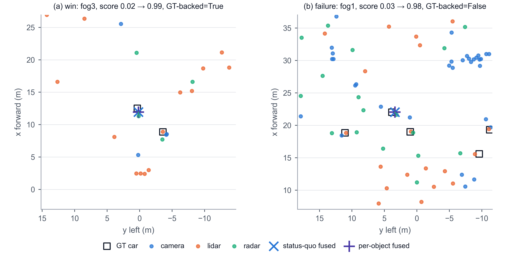

# Exp 8 — Qualitative cases

Adverse test candidates with ≥ 2 sensors: per-object arm fixes the status quo in 18714 cases and breaks it in 5464 cases.

## win



```
{'kind': 'win', 'frame': {'frame_id': '1598988320569023', 'scene': 22, 'split': 'test', 'condition': 'fog', 'severity': 3}, 'evidence_gain': {'lidar': 0.31, 'radar': 0.01}, 'range_share': {'lidar': 1.0, 'radar': 0.0}, 'score_status_quo': 0.01703999750316143, 'score_object': 0.9876018166542053, 'gt_backed': True, 'range_m': 11.933473587036133, 'harm_prob': [0.0, 0.0, 0.00800000037997961], 'figure': 'qualitative_cases.png'}
```

## failure


```
{'kind': 'failure', 'frame': {'frame_id': '1598990020898242', 'scene': 37, 'split': 'test', 'condition': 'fog', 'severity': 1}, 'evidence_gain': {'lidar': 0.3, 'radar': 0.01}, 'range_share': {'lidar': 1.0, 'radar': 0.0}, 'score_status_quo': 0.02632170543074608, 'score_object': 0.9753339290618896, 'gt_backed': False, 'range_m': 22.29705047607422, 'harm_prob': [0.0, 0.0, 0.0020000000949949026], 'figure': 'qualitative_cases.png'}
```

